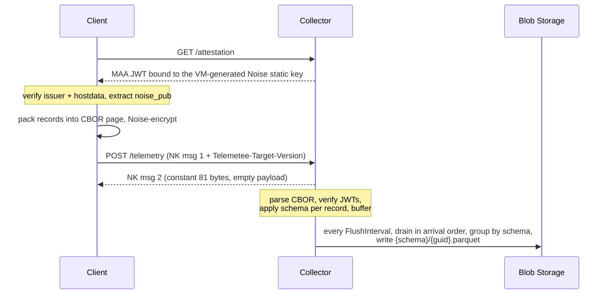

# telemetee

Anonymizing telemetry collector for Bitwarden clients. The collector runs in a Confidential ACI
container. Every client verifies the container by attestation before it sends anything.

## What it does

- Accepts fixed-size encrypted pages from pre-attested clients over a Noise channel.
- Applies a declared per-field schema (`keep`, `bucket`, `pseudonymize`, `authed`).
- Batches records in arrival order, stamps each with the flush time, and writes them to Azure
  Blob Storage as Parquet under a per-schema virtual directory. The sink holds a per-schema tail
  cache so partial chunks roll forward into the next flush instead of becoming small blobs; each
  Parquet row carries its own `batch_time` column, so per-row stamp accuracy stays at
  `FlushInterval` even when a blob mixes rows from several flushes.
- Supports both anonymous and authenticated schemas. A schema is one or the other, never both.

## How a request flows



Each plaintext page is `uint16-BE body_length || CBOR body || 0x00 padding`. The body is a single
map:

```
{
  auths:  [<jwt>, ...]                              # deduped, insertion-ordered token table
  events: [
    [<auth_idx>, <record>],                         # authed: 2-element array; index into "auths"
    [<record>],                                     # unauthed: 1-element array
    ...
  ]
}
```

If two authed records use the same token, they share a single `auths` entry, so the ~700-byte JWT
is written once per user per page rather than per record. The `events` array is in strict
submission order, so the collector sees records in the sequence the client produced them.

## Schemas

A `[Telemetry]`-attributed POCO under `src/Telemetee.Telemetry/TelemetryData/` is one schema.
Every property declares one treatment:

| Attribute          | Effect on the output                                                                  |
| ------------------ | ------------------------------------------------------------------------------------- |
| `[Keep]`           | Passed through verbatim.                                                              |
| `[Bucket(nameof)]` | Replaced by the range label the bucketer returns; records that fall off the end drop. |
| `[Pseudonymize]`   | Client-supplied value HMAC-SHA256ed under the per-boot salt.                          |
| `[Authed(claim)]`  | Client-supplied value verified against the named JWT claim, then HMAC-pseudonymized.  |

Declaring any `[Authed]` field makes the schema an authed schema. Its records only ride inside an
authed group, and a value that does not equal the JWT claim is rejected as `claim_mismatch`.

The OpenAPI document reflects the full schema set with a `oneOf` discriminator keyed on `schema`.
`support/generate-client-bindings.sh` regenerates `crates/telemetee-api/` from it, so the Rust
client's `TelemetryRecord` enum stays in step with the C# POCOs.

## Decisions

**VM-level TEE, not enclaves.** The collector runs on Confidential ACI's SEV-SNP rather than an
SGX enclave runtime like EGo. The enclave model would shrink the measured TCB from the whole guest
OS to just Noise, JWT verify, and schema handling, but the Azure platform is closing it off:
DCsv3/DCdsv3 (the current SGX SKUs) retire October 2029 with new subscriptions cut off November 1,
2026, and the successor Intel DC-family SKU (DCesv6) is TDX — a VM-level TEE. The industry has
converged on VM-level TEEs (SEV-SNP, TDX, Arm CCA), and the levers inside that model — a chiseled
runtime image, a CCE policy that pins env and exec surface, and digest-pinned reproducible
builds — are what this deployment uses.

**No URL versioning.** Both endpoints are at the root. A client pins a CCE policy hash per build,
so an older client cannot trust a newer collector's attestation anyway; routing multiple versions
behind one API would silently misroute stale clients. The `Telemetee-Target-Version` header
exists only to catch misconfigured infrastructure.

**Order-preserving batches, no shuffle.** The flusher drains in arrival order and stamps every
record with the batch time. A `GROUP BY <pseudonymized field>` query at the sink reads that key's
events in the order they happened, within one flush window. Per-event timestamps never leave the
collector.

**Dedup table + per-event auth index.** A JWT dominates each record's byte budget. The CBOR body
carries one deduped `auths` table and tags each event with an index into it, so a token used by N
events on a page is written once and referenced N times. Keeping events in a single flat array
preserves submission order across authed and unauthed records without a sort pass on either side.
CBOR saves another 10–20% on event bodies versus JSON without inventing a format;
`System.Formats.Cbor` and `ciborium` on each side, no custom codec.

**`[Authed]` verifies, it does not populate.** The client sends the plaintext id it asserts the
record belongs to, and the collector rejects on mismatch. A silent server-side overwrite would
mask a drifted session (a stale token or a swapped login); surfacing it as `claim_mismatch`
exposes the drift.

**Typed sends only.** `CollectorClient::send` takes `&mut Vec<Submission>`, where `Submission` is
`Authed { token, event } | Unauthed(event)` and `event` is a generated `TelemetryRecord` variant.
The queue is drained in submission order. Records that did not reach the wire remain at the front
on `Err(Error::PartialSend { .. })`, so a caller's queue is also its retry buffer. The raw
page/byte path is crate-internal, and anything other than a known schema is a compile error on
the client.

**JSON as the schema layer's internal value model.** `SchemaApplier` and `IBucketer` consume
`JsonElement`. Pages arrive in CBOR, so `TelemetryHandler.ReadEventAsJson` transcodes each event
CBOR → JSON before applying the schema. The transcoding cost (per-event buffer, UTF-8 writer,
`JsonDocument.Parse`) is accepted today for one well-understood value model in the schema layer
and the convenience of writing tests against JSON literals. Revisit if throughput demands it: the
next step is a neutral `TelemetryValue` tree populated directly from `CborReader`, with the
applier and bucketers rewritten against it — not switching the wire to JSON, which would give
back the page density that CBOR exists to buy.
