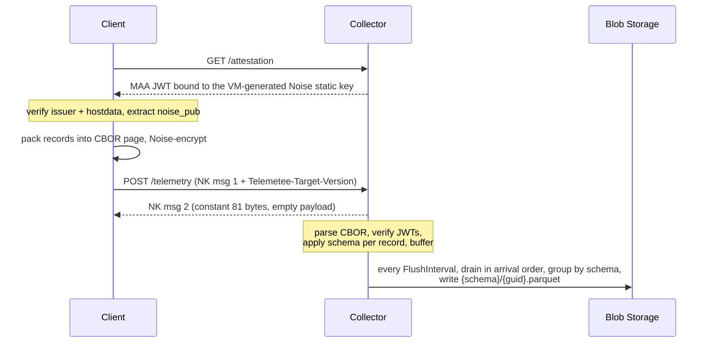

# Architecture: the request path

A client makes two kinds of request to the collector: `GET /attestation` to prove the
container's identity, then `POST /telemetry` to deliver a page of records over an attested
Noise channel.

## Request flow



## Request and response size

Each POST carries one page and performs one NK handshake. The request body is exactly 4096
bytes. The collector rejects any other length before it runs the handshake, so the edge sees
a constant request size. The response is NK message 2 wrapping an empty payload — exactly 81
bytes (`PageFormat.ResponseLength`) of handshake and AEAD overhead. On handshake failure the
collector returns 81 bytes of random noise so the shape matches the success path.

Per-record outcomes live only in the collector's `telemetee.batch.records_accepted` and
`telemetee.batch.records_dropped` counters, not communicated to the client in any way.

## Plaintext page layout

The plaintext page is `uint16-BE body_length || CBOR body || 0x00 padding`. The CBOR body is a
single map:

```cbor
{
  "auths":  [<jwt>, ...],                        // deduped, insertion-ordered table
  "events": [
    [<auth_idx>, <event>],                       // authed: 2-element array; index into "auths"
    [<event>],                                   // unauthed: 1-element array
    ...
  ]
}
```

Each event is a CBOR map with a `schema` discriminator and the schema's fields. The `events`
array is in strict submission order. If two authed records use the same token, they share one
entry in `auths`. The ~700-byte JWT appears once per user per page, not once per record.

The maximum record length is 1024 bytes. The collector drops a record over the cap, counts it,
and continues through the rest. The client drops oversized records before any crypto work and
returns them to the caller in `SendOutcome.oversize_dropped`.

## Version header

Every `POST /telemetry` must carry `Telemetee-Target-Version` equal to the collector's
assembly version. The collector rejects a mismatched or missing header with 400 before any
crypto work. The rejection counts on `telemetee.pages` under outcome `rejected_version`. The
handler never sees a page from a client that disagrees about the version, so field semantics
cannot drift silently if a schema changes.

See [decisions.md](decisions.md#why-version-lives-outside-the-api) for why the version is a
header rather than a URL segment.

## Endpoints

The collector hosts only one api version at a time (see [decisions.md](decisions.md#why-version-lives-outside-the-api)).

Production:

| Method | Path           | Purpose                                                                                |
| ------ | -------------- | -------------------------------------------------------------------------------------- |
| GET    | `/attestation` | `{ "token": "<MAA JWT>" }` with `x-ms-runtime.noise_pub`                               |
| POST   | `/telemetry`   | Exactly one 4096-byte NK message 1 page in, exactly 81 bytes of empty NK message 2 out |

Development only (not registered in Production):

| Method | Path                     | Purpose                                                                                        |
| ------ | ------------------------ | ---------------------------------------------------------------------------------------------- |
| GET    | `/openapi/v1.json`       | OpenAPI document; the client-binding generator reads it                                        |
| GET    | `/dev/attestation/certs` | JWKS for the development issuer                                                                |
| POST   | `/dev/telemetry`         | Plaintext unauthed `TelemetryRecord` in, anonymized output back                                |
| POST   | `/dev/telemetry/authed`  | Same, plus `Authorization: Bearer <jwt>`; claims are parsed and `[Authed]` fields are verified |

Plus `/version` and `/healthz`.
